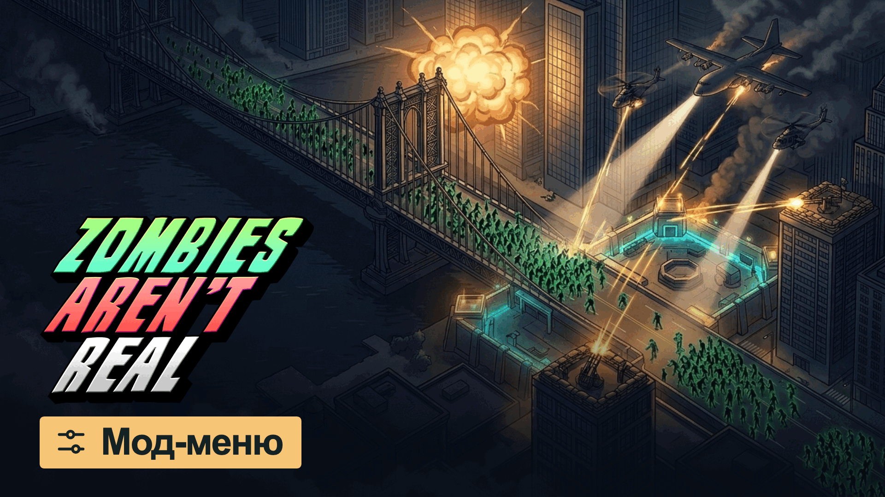
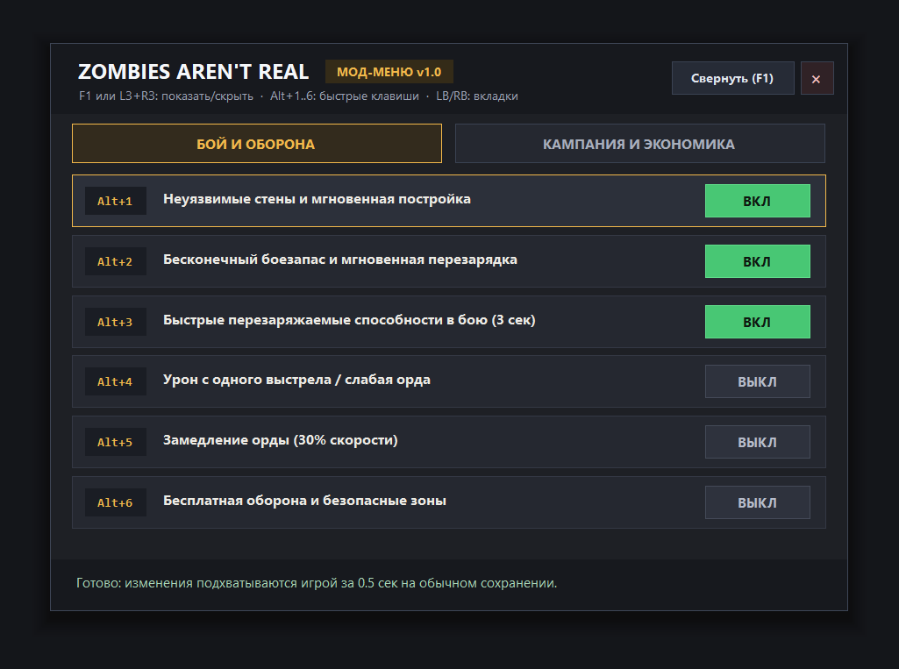
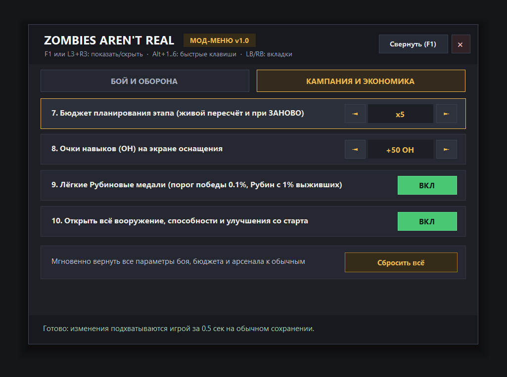
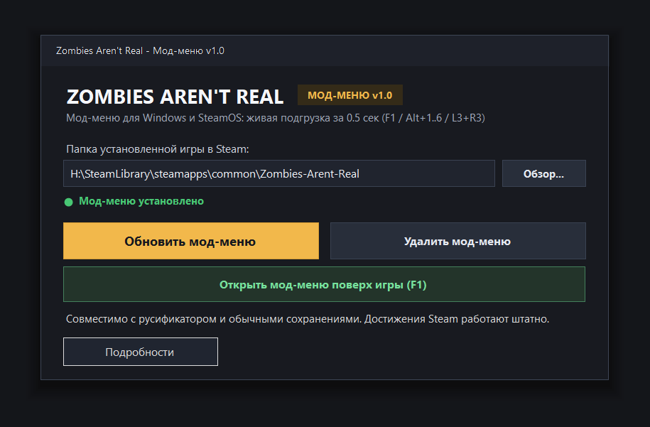
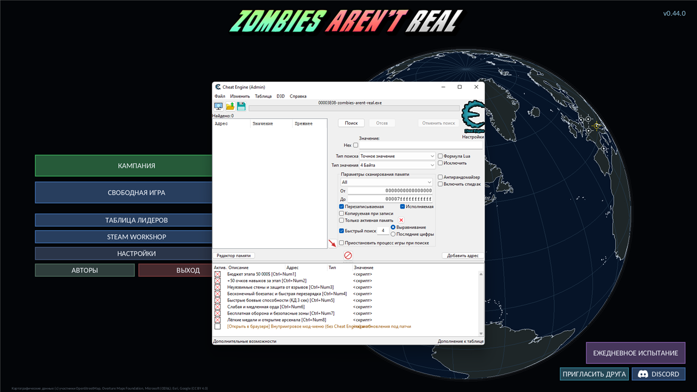

# Zombies Aren't Real · Внутриигровое мод-меню

Внутриигровое мод-меню на русском языке с десятью функциями настройки баланса для обороны города и кампании (живая подгрузка в запущенной игре за полсекунды на обычном сохранении).

- **[Скачать мод-меню v1.0 (ZIP)](https://github.com/neoru-droid/zombies-arent-real-trainer-ru/releases/download/v1.0.0/ZombiesArentReal-Trainer-RU-v1.0.zip)** · [Как установить](#установка)
- **[Скачать таблицу Cheat Engine v1.0 (.CT в ZIP)](https://github.com/neoru-droid/zombies-arent-real-trainer-ru/releases/download/v1.0.0/ZombiesArentReal-CheatTable-RU-v1.0.zip)** · [Как подключить .CT](#таблица-cheat-engine-ct)
- **[Единая страница с русификатором 2-в-1 на Boosty](https://boosty.to/cd_tixo/posts/0ec0506b-063f-4be2-a788-40ebe320add7?utm_source=github&utm_medium=readme&utm_campaign=zombies_arent_real)**

Подготовлено под патч 0.44.0 (сборка Steam `26799228`) для **Windows** (`F1`, `Alt+1..6`, геймпад `L3 + R3`) и **Steam Deck / Linux** (`install-steamdeck.sh`). Сохранения игры и достижения Steam продолжают работать как обычно.

При выключении переключателей и удалении мод-меню оригинальные файлы игры возвращаются в один клик. Уже полученные в кампании медали, накопленный бюджет и записанные в сохранение разблокировки остаются у игрока.

## Установка

1. **Windows:** распакуйте архив и запустите `ZombiesArentReal-Trainer-Setup.exe` -> **«Установить мод-меню»**, затем нажмите **«Открыть мод-меню поверх игры (F1)»** (при окне SmartScreen: «Подробнее» -> «Выполнить в любом случае»). В папку игры также копируется `ZombiesArentReal-Trainer.exe` для быстрого запуска оверлея.
2. **Steam Deck / Linux:** распакуйте файлы архива в одну папку и выполните `sh install-steamdeck.sh` (на Рабочем столе Steam Deck откроется окно выбора функций `zenity`, либо передайте флаги `--install`, `--enable`, `--uninstall` в терминале).
3. **Удаление:** запустите установщик повторно и нажмите **«Удалить мод-меню»** (или `sh install-steamdeck.sh --uninstall`). Полностью совместимо с оригинальной игрой и с [русификатором текста](https://github.com/neoru-droid/zombies-arent-real-ru) - резервные копии хранятся раздельно, оба пакета ставятся и удаляются в один клик в любом порядке.

## Возможности (10 функций)

### Вкладка «Бой и оборона»
1. **Неуязвимые стены и мгновенная постройка** (`Alt+1`) - стены выдерживают натиск орды и взрывных мутантов, возводятся в бою мгновенно и без лимита длины одиночных преград.
2. **Бесконечный боезапас и мгновенная перезарядка** (`Alt+2`) - снимает лимит перезарядок (`max_reloads = -1`) и сокращает перезарядку до `0.05` сек у гарнизонов, снайперов, миномётов, гаубиц, РСЗО, турелей, рельсотронов, линкоров, вертолётов, БТР и танков.
3. **Быстрые перезаряжаемые способности в бою** (`Alt+3`) - снимает стартовую задержку вызова и включает автоматическую перезарядку каждые `3` сек для всех 19 боевых способностей (от десанта и авиаудара до лекарства и ядерного заряда).
4. **Урон с одного выстрела / слабая орда** (`Alt+4`) - снижает здоровье обычных зомби, гигантов и мутантов до `0.1` без роста по ходу боя и обнуляет броню щитовиков.
5. **Замедление орды** (`Alt+5`) - снижает скорость передвижения орды и пловцов примерно до `30%` от обычной.
6. **Бесплатная оборона и безопасные зоны** (`Alt+6`) - обнуляет стоимость размещения и укрепления всех огневых точек, мин, стен, ворот, коридоров эвакуации и безопасных зон, расширяя лимит числа и площади зон.

### Вкладка «Кампания и экономика»
7. **Бюджет планирования** - выбор множителя бюджета этапа (`x1 / x2 / x5 / +$50 000`); пересчитывается в фазе планирования и при нажатии «Заново» за полсекунды.
8. **Очки навыков (ОН)** - выбор количества очков навыков для экрана оснащения (`x1 / x2 / x5 / +50 ОН`).
9. **Лёгкие Рубиновые медали (1% выживших)** - снижает порог победы до `0.1%`, а порог высшей Рубиновой медали до `1%` спасённых жителей на любом этапе кампании.
10. **Открыть всё вооружение, способности и улучшения со старта** - переносит весь арсенал из очереди прогрессии в стартовый набор и открывает доступ к улучшениям башен.

*При каждом новом запуске оверлея боевые переключатели (`1..6`) выключены по умолчанию. Между сеансами сохраняются только выбранные настройки кампании и экономики.*

## Управление

- **Открыть / скрыть оверлей на Windows:**
  - Клавиатура: `F1`
  - Геймпад (XInput): одновременное нажатие обоих стиков `L3 + R3`
- **Быстрые клавиши в бою на Windows:** `Alt + 1` .. `Alt + 6` (переключают функции без сворачивания игры с компактным уведомлением в углу экрана).
- **Навигация с геймпада:** `LB / RB` - смена вкладки, крестовина вверх/вниз - выбор строки, крестовина влево/вправо - переключение режима бюджета и ОН, `A` - включить/выключить, `B` (или `Esc`) - свернуть окно.

## Как выглядит меню

**Вкладка «Бой и оборона»**

**Вкладка «Кампания и экономика»**

**Установщик**

## Таблица Cheat Engine (.CT)

Автономная таблица `ZombiesArentReal_RU_v1.0.CT` для Cheat Engine 7.7 меняет баланс в памяти без изменения файлов игры (`zombies-arent-real.exe`).

1. `Бюджет этапа 50 000$` (`Ctrl+Num1`) - увеличивает бюджет планирования.
2. `+50 очков навыков за этап` (`Ctrl+Num2`) - выдаёт очки навыков для экрана оснащения.
3. `Неуязвимые стены и защита от взрывов` (`Ctrl+Num3`) - убирает разрушение стен и урон от взрывных зомби.
4. `Бесконечный боезапас и быстрая перезарядка` (`Ctrl+Num4`) - снимает лимит перезарядок и ускоряет перезарядку турелей, миномётов, снайперов, гаубиц, РСЗО, рельсотронов, линкоров и техники.
5. `Быстрые боевые способности (КД 3 сек)` (`Ctrl+Num5`) - открывает вызов способностей и сокращает ожидание.
6. `Слабая и медленная орда` (`Ctrl+Num6`) - снижает здоровье и скорость передвижения зомби.
7. `Бесплатная оборона и безопасные зоны` (`Ctrl+Num7`) - обнуляет стоимость обороны и расширяет лимит безопасных зон.
8. `Лёгкие медали и открытие арсенала` (`Ctrl+Num8`) - снижает пороги медалей до `0.1 - 1.0%` и открывает ветки улучшений.

Как подключить: запустите игру -> откройте `ZombiesArentReal_RU_v1.0.CT` через `File -> Load` в Cheat Engine -> выберите процесс `zombies-arent-real.exe` -> активируйте нужные строки по одной или клавишами `Ctrl+Num1` .. `Ctrl+Num8` (не нажимайте `Ctrl+A` в окне Cheat Engine).

## Обратная связь и ссылки

Об ошибке можно написать в [Issues](https://github.com/neoru-droid/zombies-arent-real-trainer-ru/issues).

[Все версии](https://github.com/neoru-droid/zombies-arent-real-trainer-ru/releases) · [Русификатор Zombies Aren't Real](https://github.com/neoru-droid/zombies-arent-real-ru) · [Каталог на Boosty](https://boosty.to/cd_tixo/posts/2a55d7e9-0f53-4d93-9f66-280981158dec?utm_source=github&utm_medium=readme&utm_campaign=zombies_arent_real) · [Каталог с поиском](https://neoru-droid.github.io/)
